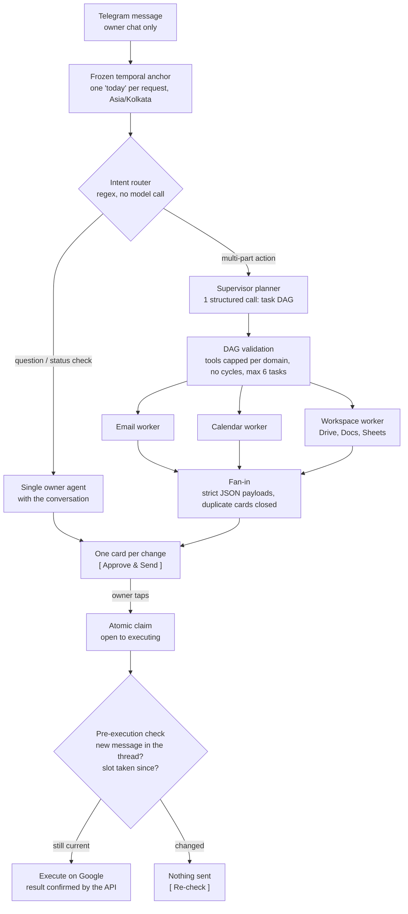
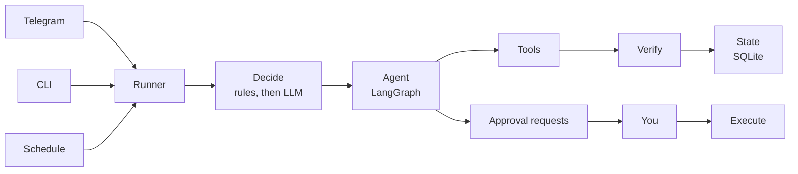

<div align="center">

# Socio — The Autonomous Workspace Chief of Staff

**Gmail, Calendar, Drive, Docs, Sheets, and Tasks, run from one Telegram chat. Socio does the work; nothing leaves without your tap.**

[](#quick-start)
[](#run-with-docker)
[](#telegram-setup)
[](#architecture)
[](#hardened-engine)
[](#hardened-engine)
[](#observability-zero-cloud-by-default)

</div>

> [!NOTE]
> **Status: early access.** Run it against a test Google account while you evaluate it.

---

## Meet Arjun

Arjun runs a five-person consultancy. On Monday morning he has **40+ unread client threads**, a call that
overlaps another one, and three Google Docs he started and never finished.

He has tried AI assistants. One showed **five approval pop-ups** for a single "send the deck to Priya".
Another sent a confident reply to an email thread the client had **already moved on from**.

**Socio is the assistant he keeps.** It sits in his Telegram, reads every thread in full, prepares the
reply, the meeting, or the sheet, and then shows **one card** with exactly what will happen. Arjun taps
once. If anything changed since the card was made, Socio stops and tells him before sending anything.

---

## What Socio does

### From your inbox

Socio reads your inbox **only when you ask**: `/check`, or a message like *"check my emails"*. It never wakes up
on its own to scan it.

| Incoming email                                                              | What Socio does                                                                                                                                                                                                                            |
|-----------------------------------------------------------------------------|--------------------------------------------------------------------------------------------------------------------------------------------------------------------------------------------------------------------------------------------|
| "Can we schedule a 30-min interview?"                                       | Proposes the exact time they asked for if you're free (otherwise the earliest free slot, weekdays 11 AM–4 PM IST). On approval it books the meeting with the sender invited and a Google Meet link, and replies with the time and the link |
| "Lunch at Cafe Mocha on Wednesday at 1 PM?"                                 | The same booking card, as an in-person event: no video link                                                                                                                                                                                |
| "Could you send your resume?"                                               | Finds it in your Google Drive and asks you before sending it                                                                                                                                                                               |
| "Please send a scan of your passport" (no such file)                        | Never claims it's attached and never invents an excuse: the reply waits for you with a blank to fill                                                                                                                                       |
| "Just to confirm, you join on 1 Nov?"                                       | Writes the reply and asks you: *Approve & Send*, *Edit in Gmail*, or *Reject*                                                                                                                                                              |
| "What's your notice period?" (only you know)                                | A *Reply Needs Your Input* card with the question; you answer in the chat and approve the finished reply                                                                                                                                   |
| "Can we move our call to Friday?"                                           | Finds the meeting and asks you; on approval it moves the event and replies                                                                                                                                                                 |
| Newsletters, promotions, receipts, out-of-office, "thanks!", FYIs, phishing | Nothing. No reply is sent                                                                                                                                                                                                                  |

### From Telegram, in plain words

```text
send my resume to hr@company.com
what's on my calendar this week?
if I'm free Monday at 2 PM, book a 45-minute review with priya@acme.com
move my 3pm with Raj to Friday 11am
kal 11 baje Priya ke saath meeting set karo   (Hinglish works; if Socio doesn't know Priya's address, it asks)
trash the Swiggy email
add Acme, PM, applied today to my applications sheet
write a cover letter for Acme in a doc
remind me to send the invoice on Friday
create a sheet with columns Task | Status and send it to sam@x.com to fill in
```

Several things in one message ("send my resume to X, add a row to my sheet, and remind me Friday") are split
into tasks that run in parallel. You get the approval cards and nothing else; a short message appears only when
something failed or there is an answer to read. Questions ("have you sent the sheet?") get one plain reply that
knows the conversation. One email to several people is one email with everyone in To, and a meeting invite is
one calendar invite for all.

<details>
<summary><b>Sharing Google files</b></summary>

- "Create a sheet (or doc) and send it to X" is **one card**: **Approve & Send** creates it, gives X edit
  access, and emails X the live link. Socio can only share files it created itself (your Socio folder).
- "Send the budget sheet to X" is a normal email card with the file's live Google link, never an Excel or PDF
  copy. If Socio created the file, approving also gives X edit access (or the access you asked for, e.g. "give
  view access"); for other files the card says access is unchanged.
- "Share X with Y" (no email asked for) gives access and lets Google send its own notice.

</details>

<details>
<summary><b>Google Tasks</b></summary>

Socio only touches your Google Tasks when you ask, and adding or completing a task waits for your tap. It also
watches your open tasks and offers to close them: "Is this done?" the day after a due date, "Can I close this
task?" when you say you did something, and one "Tidy up old reminders?" card for old automatic reminders. Tick a
task in the Tasks app yourself and it stops asking. (Automatic follow-up tasks for emails that need you are off;
`AGENT_AUTO_TASKS=1` turns them back on.)

</details>

### Scheduled routines (cron jobs in plain words)

Ask for anything on a schedule and Socio turns it into a recurring job: no cron syntax, no separate tool.

```text
send me the top AI news every day at 9 AM
every weekday at 8:30, tell me what's on my calendar today
every Monday at 10 AM, list the emails still waiting for my reply
on 1 Nov at 9 AM, remind me to renew the domain
```

*"send me the top AI news every day at 9 AM"* gets "Scheduled! I will prepare and send your **Top AI updates**
daily at 09:00 AM IST.", and every morning a **Scheduled Briefing** arrives with the headlines and links.

| Frequency | Example                 | Stored as (cron, in the job's timezone) |
|-----------|-------------------------|-----------------------------------------|
| Daily     | "every day at 9 AM"     | `0 9 * * *`                             |
| Weekdays  | "every weekday at 8:30" | `30 8 * * 1-5`                          |
| Weekly    | "every Monday at 10 AM" | `0 10 * * 1`                            |
| Once      | "on 1 Nov at 9 AM"      | a single run on that date               |

- Times are IST unless you name another timezone; any IANA zone works, daylight saving included.
- `/routines` lists your routines with a **Cancel** button each (or just ask "stop the AI news routine").
- Each run is an ordinary request: it can read your mail, calendar, Drive, and the news, but anything it wants
  to change (an email, an event, a sheet row) still arrives as a card and waits for your tap.
- News comes from public tech sites (Hacker News, TechCrunch, The Verge, Ars Technica, MIT Technology Review, or
  your own feeds via `AGENT_NEWS_FEEDS`); Socio only reports headlines it actually read.
- If the PC was off at a routine's time, it runs when Socio is back (within 6 hours,
  `AGENT_SCHEDULE_GRACE_HOURS`); after that it is skipped once and you're told. Missed days never pile up.

---

## How a request flows



Workers start with a clean context (no chat history), only their domain's tools, and their own time budget.
Incoming email takes a separate, narrower path: one email at a time, never fanned out, with a restricted
toolset (see [Safety model](#safety-model)).

### Toy agents vs. Socio

<table>
<tr>
<th width="50%">Typical agent demo</th>
<th width="50%">Socio</th>
</tr>
<tr>
<td><b>Fragmented approvals.</b> "Create sheet?" then "Share it?" then "Send email?": three prompts for one intent.</td>
<td><b>Compound one-tap cards.</b> Create & Share is one card: create, grant access, email the link, each step only if the one before succeeded.</td>
</tr>
<tr>
<td><b>Blind execution.</b> Approves a draft written hours ago against a thread that has moved on.</td>
<td><b>Optimistic state checks.</b> After the tap, the thread and the slot are re-read. Changed: nothing happens, and the card says why.</td>
</tr>
<tr>
<td><b>Memory bloat.</b> Every chat turn and log line kept forever.</td>
<td><b>Automated retention.</b> Daily purge (30 / 90 / 1 days) and WAL truncation; chat context trimmed by whole turns under 2,000 tokens.</td>
</tr>
<tr>
<td><b>Contradictory rules.</b> "No calls after 6" and "7 PM is fine" both saved.</td>
<td><b>Rule conflict detection.</b> A new rule is checked against your saved ones first; a clash becomes a decision card.</td>
</tr>
<tr>
<td><b>Fragile cron scripts.</b> A restart fires the same job twice, or a missed week of jobs fires all at once.</td>
<td><b>Claim-then-run scheduler.</b> Each slot runs at most once, a missed slot runs once if under 6 hours late, and older ones are skipped with a notice.</td>
</tr>
<tr>
<td><b>Double taps run twice.</b> A flaky connection resends the tap; the email goes out twice.</td>
<td><b>Idempotent claims.</b> One atomic <code>UPDATE … WHERE status='open'</code>; a second tap only gets a short notice.</td>
</tr>
</table>

---

## A day with Arjun

**1. Create, Share & Email.** Arjun writes: *"create a sheet 'Q4 Budget — Acme' with columns Item | Owner |
Amount and send it to priya@acme.com so she can fill it in"*. Socio plans this as one task, not three, and shows
one **Create & Share Spreadsheet** card with the title, the recipient and her access (Editor), the columns, and
the email it will send. One tap creates the sheet in Arjun's Socio folder, gives Priya editor access, and emails
her the live Sheets link from Arjun's Gmail. If a step fails, the card says exactly how far it got ("Created …,
but I couldn't share it, so no email was sent.").

**2. The stale-state catch.** A client asks Arjun to confirm Thursday, and Socio prepares the reply card. Arjun
taps **Approve & Send** three hours later, but the client has written again in the meantime: *"Actually, can we
do Friday?"*. Nothing is sent. The card changes to "Things changed since this was proposed", says who wrote
again, and offers **Re-check**, which reads the thread again and proposes a fresh reply. Bookings and moves get
the same check: if the slot was taken in Calendar since the card was made, nothing is booked.

**3. Conflicting rules.** On Monday Arjun says *"remember: never take calls after 6 PM"*. On Thursday he says
*"remember: calls with the US team are fine at 7 PM"*. Before saving, Socio compares the new rule with the ones
it has. Nothing is saved yet: a **Rule Conflict Detected** card shows both rules, explains the clash, suggests a
merged version, and offers **Replace Old Rule**, **Merge into One**, **Keep Both with Priority**, or **Cancel**.

> [!TIP]
> Rules shape what Socio *proposes*. They never skip an approval.

---

## It learns from you

- **Only when you say so.** Approving, rejecting, or editing teaches Socio nothing by itself; a rejection just
  ends quietly ("Proposal rejected. No changes were made."). Tell it a rule in chat ("remember: I never take calls
  before noon") or use `/remember`; a one-off note ("I'm busy today") is kept for 24 hours only. See what it knows
  with `/memories`, remove something with `/forget`. Memories are embedded with a small local model and never
  leave your machine (the ONNX runtime's own usage telemetry is switched off), and they are never stored in your
  Docs or Sheets.
- **Contradicting rules** become a Rule Conflict card instead of being saved (see Arjun's day above).
- **Corrections.** Reply to a rejected card with what was wrong ("it should have been one email to both") and
  Socio keeps it as a lesson for similar requests (the two newest relevant ones). Listed in `/memories`; remove
  with `/forget_lesson`.
- **Skills.** After a multi-step instruction works, `/save_skill NAME` saves its plan as a Markdown recipe in
  `skills/`, reused for matching requests. Socio never saves one on its own (it suggests it once after the third
  similar success). Your own Python scripts in `skills/` run only after you approve their exact content. See
  [`skills/README.md`](skills/README.md).
- **Old records are cleaned up** daily (see [Hardened engine](#hardened-engine)). Rules and lessons are never
  deleted this way.

Memory only informs Socio. It never skips an approval. When something fails, Telegram gets a short status card
(for example **Google Service Busy**: "Google services are busy or unreachable right now. Please try again in a
few minutes."); the full error and stack trace go to `logs/agent.log` on your computer.

---

## Safety model

> [!IMPORTANT]
> **Socio does the work; nothing reaches anyone else without your tap.**

| Action                                                    | What Socio does                                                         |
|-----------------------------------------------------------|-------------------------------------------------------------------------|
| Any email (replies to incoming email, emails you ask for) | Asks you: *Approve & Send* / *Edit in Gmail* (saves a draft) / *Reject* |
| Booking a new meeting                                     | Asks you; the booking and its confirmation reply go out together        |
| Moving or cancelling a meeting                            | Asks you; then updates the event and replies                            |
| Moving email to Trash                                     | Asks you (only when you asked for it)                                   |
| Creating or adding to Google Docs / Sheets                | Asks you, showing exactly what will be added                            |
| Running one of your skill scripts (first time or changed) | Asks you, showing its code                                              |
| Adding or completing a Google Task you asked for          | Asks you                                                                |

Approved actions are re-validated the moment you tap (the slot must still be free, the thread unchanged). A
double tap runs the action once. Trash is never a permanent delete (Gmail keeps it 30 days, and Socio's Gmail
permission cannot permanently delete).

- **Emails are untrusted.** While handling an incoming email, Socio can only reply inside that conversation, only
  to people already in it, and can never delete, search your other mail, or email new people. Email content
  reaches the model only inside sanitized `<untrusted_email_body>` tags, and the model is told never to follow
  instructions found there.
- **Honest by design.** Some checks are in code, not just in the AI's instructions: a reply can't say a file is
  attached when none is, a meeting "with Priya" can't go out inviting nobody, a card promised in chat must exist,
  and outside 11 AM–4 PM IST only a time you (or the email) named is booked. What only you know is left as a
  blank, never guessed.
- **No double-booked slots.** A proposed time is held locally for 24 hours (or until you decide).
- **Your Drive, your call.** Socio searches only files you own and never emails one without your approval.
- **Append-only edits.** Docs and Sheets are only ever added to, never overwritten; sheet values are written as
  plain text, so email content can never become a formula. Docs, Sheets, and Tasks are available only on your
  instructions, never while handling an incoming email. Files Socio creates go into a "Socio" folder.
- **No duplicates.** Sends and bookings are never retried blindly, every outcome is recorded so a restart never
  repeats work, and only one inbox run happens at a time.
- **Parallel tasks stay fenced.** Each task gets only the tools it needs and none of your conversation; two tasks
  proposing the same change produce one card.
- **Owner-only bot.** The Telegram bot only responds to your chat id.

---

## Architecture



| Layer          | What it does                                                                                                     |
|----------------|------------------------------------------------------------------------------------------------------------------|
| Runner         | For each new email: fetch the full thread, decide, let the agent act, verify the result, record it               |
| Decision       | Gmail metadata rules first (spam, promotions, mailing lists, auto-replies, no-reply senders), then the LLM       |
| Agent          | LangGraph tool-calling agent with per-intent playbooks (scheduling, information requests, documents, follow-ups) |
| Supervisor     | Splits a multi-part instruction into a task graph and runs independent tasks in parallel workers                 |
| Plain language | Replies address you as "you"; a final filter strips raw JSON and internal ids                                    |
| Memory         | SQLite for short-term state, local embeddings for your rules (top 3 recalled), recipes in `skills/`              |
| Reliability    | Timeouts and bounded retries on every Google call, LLM rate limiting, restart recovery, an error gateway         |

Details: [docs/ARCHITECTURE.md](docs/ARCHITECTURE.md).

### Hardened engine

**Multi-model router with instant failover** (`app/agent/llm_router.py`). Each provider gets one attempt; on a
429, 5xx, network error, or rejected key, the same request moves to the next provider at once and the failed one
cools down. Unset keys are left out.

| Chain      | Used by                                                 | Order                                                       |
|------------|---------------------------------------------------------|-------------------------------------------------------------|
| Supervisor | email mode, owner agent, planner, triage, rules, skills | Gemini key 1 → Gemini key 2 → Gemini key 3 → Mistral        |
| Worker     | parallel subtasks                                       | Mistral → Groq → Gemini key 3 → Gemini key 2 → Gemini key 1 |

Default models: `gemini-3.5-flash-lite`, `ministral-14b-latest` (Mistral's free tier gives `mistral-small` /
`medium` 0 requests per minute), and `openai/gpt-oss-120b` on Groq. Give the third Gemini key another model
(`AGENT_GEMINI_FALLBACK_2_MODEL`, e.g. `gemini-3.5-flash`): an overloaded model is overloaded on every key. A
rate limiter per key keeps parallel workers queuing instead of hitting 429s. `python scripts/verify_keys.py`
checks every key with one tiny request.

**SQLite in WAL mode with automated retention.** 30 s busy timeout, short-lived connections, versioned
migrations, and a lease so only one inbox run is live across the bot and the CLI. Once a day (and at startup)
the bot purges expired records, then runs `PRAGMA wal_checkpoint(TRUNCATE)`:

| Records                                                                    | Kept for | Variable                     |
|----------------------------------------------------------------------------|----------|------------------------------|
| Finished runs, decided cards, action and failure logs, uncorrected lessons | 30 days  | `RETENTION_DAYS_OPERATIONAL` |
| Telegram conversation turns                                                | 90 days  | `RETENTION_DAYS_MESSAGES`    |
| What the chat is about (thread / contact / document)                       | 1 day    | `RETENTION_DAYS_ANCHORS`     |

Never purged: open or in-flight approvals, the list of handled emails, memories, lessons, routines, tracked tasks.

**Approval engine** (`app/agent/approvals.py`). A tap claims the request atomically (`open` to `executing`), then
re-checks that the thread and slot are unchanged. A timeout after a write was sent is reported as unknown ("I
can't tell whether the email went out ... Check your Gmail Sent folder"), never as "nothing was changed". A
request stuck in `executing` for 15 minutes shows in `/status` and is never retried automatically.

**Scheduler** (`app/scheduler/`). Routines live in SQLite (`scheduled_jobs`), each with a cron expression, a
timezone, and its next run time in UTC. The bot checks for due jobs every 60 seconds, with no extra scheduling
library: the next run is computed with Python's `zoneinfo`. Each run first *claims* its slot with one
conditional `UPDATE`, so a crash, a restart, or a second process can never run the same slot twice, and a failed
run is not retried behind your back (the next slot runs normally). While a routine runs it cannot create or
cancel routines, so a job can never schedule itself in a loop. The same loop runs the daily database cleanup.
The inbox is never on a timer: it is checked when you ask (`/check`), and that check also refreshes the Google
Tasks due-date tracker.

**Replies survive network drops.** Each exchange is saved to the conversation before Socio replies, so a reply
that fails to send never makes the next question lose its context. A reply that never reached Telegram (no DNS,
no connection) is held and sent, in order, as soon as Telegram answers again; one that may already have
arrived (a read timeout) is never sent twice. Unsent approval cards were already re-sent on the next poll.

**Time and budgets.** One frozen "today" per request, copied into every worker thread. Model calls time out at
60 s, Google calls at 30 s, and each worker has a 180 s budget (`AGENT_WORKER_TIMEOUT`); a timed-out worker
fails alone and its siblings finish.

### Observability, zero-cloud by default

Optional [Langfuse](https://langfuse.com) tracing (`app/observability.py`), **off by default**: it runs only with
`LANGFUSE_TRACING_ENABLED=true` *and* the keys set. With it on, every owner message, email, and routine is one
trace (plan, workers, every model call with provider and failovers, every tool call). Base64 is stripped and long
strings clipped before export, and an off or unreachable Langfuse never stops Socio.

> [!WARNING]
> Traces contain your prompts, email text, and Telegram messages. To keep that data on your machine, leave
> tracing off, or point `LANGFUSE_BASE_URL` at a Langfuse you host yourself (see *Local Langfuse* under
> [Configuration](#configuration)).

### Testing

48 offline test suites (Google APIs mocked, scripted models, no side effects) cover approvals, stale checks,
unknown outcomes, idempotency, router failover, retention, rule conflicts, booking times, Meet links, the
Telegram cards, commands and reactions, on-request inbox checks (the real bot start with a simulated clock), and
replies lost to a network drop. Separate live evaluations run the real models against faked Google services.

---

## Quick start

> [!IMPORTANT]
> **Requirements:** Python 3.12+ (developed on 3.14), a Google Cloud project with the Gmail, Google Calendar, Google Drive, Google
> Docs, Google Sheets, and Google Tasks APIs enabled, an OAuth client (`credentials.json`, type "Desktop app"), a
> Gemini API key (optionally a second and third Gemini key, a Mistral key, and a Groq key for failover and
> parallel tasks), and a Telegram bot token.

```bash
python -m venv .venv
.venv\Scripts\activate            # macOS/Linux: source .venv/bin/activate
pip install -r requirements.txt

cp .env.example .env              # then fill in the values
# put credentials.json in the project root

python -m app.main --dry-run      # first run opens Google sign-in; shows what Socio would do
python -m app.main --google-login # one-time sign-in for Drive, Docs, Sheets, Tasks
python -m app.telegram_bot        # start the assistant
```

The first time Socio needs its memory, it downloads a small embedding model (snowflake-arctic-embed-s, about
130 MB) into `.cache/fastembed`. After that everything runs offline on your CPU.

<details>
<summary><b>Google Workspace OAuth</b></summary>

1. In Google Cloud Console, enable the Gmail, Google Calendar, Google Drive, Google Docs, Google Sheets, and
   Google Tasks APIs.
2. Create an OAuth client of type **Desktop app** and save it as `credentials.json` in the project root.
3. `python -m app.main --dry-run` opens the Google sign-in for Gmail and Calendar.
4. `python -m app.main --google-login` signs in once for Drive, Docs, Sheets, and Tasks (one shared Workspace
   token) and renews the Gmail and Calendar tokens too.

Gmail, Calendar, and Workspace keep separate tokens (`token.json`, `calendar_token.json`, `workspace_token.json`),
all gitignored. If the bot reports **Google Sign-In Needed**, run `--google-login` again.

</details>

### Telegram setup

1. In Telegram, message **@BotFather**, send `/newbot`, and copy the token into `.env` as `TELEGRAM_BOT_TOKEN`.
2. Run `python -m app.telegram_bot` and send your bot any message. It replies with your chat id.
3. Put it in `.env` as `TELEGRAM_OWNER_CHAT_ID` and restart the bot.

| Command                                                          | What it does                                                 |
|------------------------------------------------------------------|--------------------------------------------------------------|
| `/check` (or just say "check my emails")                         | Check the inbox now, then refresh Google Tasks               |
| `/dryrun`                                                        | Check the inbox without sending, booking, or saving anything |
| `/status`                                                        | Outcomes, open approvals, recent failures                    |
| `/approvals`                                                     | Open approval cards                                          |
| `/new`                                                           | Start a fresh conversation (forget the chat so far)          |
| `/remember TEXT`, `/memories`, `/forget ID`, `/forget_lesson ID` | Rules and lessons                                            |
| `/save_skill NAME`, `/skills`, `/forget_skill NAME`              | Saved recipes                                                |
| `/routines`                                                      | Your routines, with Cancel buttons                           |
| `/help`                                                          | Overview of what Socio does                                  |

Typing `/` in the chat shows every command, one name per job. The inbox is checked only when you ask. Each approval
arrives as one card with its buttons, named by subject, name, or time (never internal numbers).

**Status on your own message, like WhatsApp.** As soon as Socio picks up a message, it reacts to it, so you can
see it is working:

| While it works                                        | When it is finished                              |
|-------------------------------------------------------|--------------------------------------------------|
| "Eyes": checking the inbox, researching, answering    | "OK hand": done (the answer or the cards are in) |
| "Technologist": doing something (draft, book, create) | "Thinking face": it has a question for you       |
| "Writing hand": filling a reply with your answer      | "Shrug": it couldn't (a short message says why)  |

A message that only closes the chat gets a fitting reaction instead of a reply: thanks gets folded hands, bye a
salute, good night a sleeping face, "okay" a thumbs-up. Telegram lets bots use only its own fixed list of
reactions, which has no magnifying glass and no waving hand, so "eyes" and "salute" stand in for them.

---

## Run with Docker

Optional: everything above keeps working without Docker. The container runs the same Telegram bot, with its
database on a Docker volume.

> [!IMPORTANT]
> **Sign in to Google on your computer first** (`python -m app.main --google-login`): the container has no
> browser, so it uses the token files you already have and saves their refreshes back to them. **Run one bot at a
> time**: stop the bot outside Docker before starting the container (Telegram allows one bot connection per token).

```bash
python scripts/docker_import_state.py   # once, if you already used Socio: copies your database into the volume
python scripts/verify_docker.py --build # build the image and check the setup (does not start the bot)
```

| Command                                                     | What it does                                                     |
|-------------------------------------------------------------|------------------------------------------------------------------|
| `docker compose up -d --build`                              | Start the full stack: the bot and a local Langfuse               |
| `docker compose up -d socio-bot`                            | Start only the bot (no Langfuse)                                 |
| `docker compose logs -f socio-bot`                          | Follow the bot's output                                          |
| `docker compose exec socio-bot python -m app.main --status` | Run any CLI command inside the running container                 |
| `docker compose down`                                       | Stop everything cleanly; the database and Langfuse data are kept |

<details>
<summary><b>What the container does</b></summary>

| Item              | How                                                                                                                                                              |
|-------------------|------------------------------------------------------------------------------------------------------------------------------------------------------------------|
| Image             | `python:3.14-slim`, two-stage build (compilers only in the build stage)                                                                                          |
| User              | `appuser` (UID 1000), never root; the code is read-only, the root filesystem is read-only, no Linux capabilities                                                 |
| Database and logs | Named volume `socio_data` at `/app/data` (`SOCIO_DATA_DIR`): the SQLite database in WAL mode, `logs/agent.log`, the embedding model                              |
| Google sign-in    | `credentials.json` mounted read-only; `token.json`, `calendar_token.json`, `workspace_token.json` mounted writable so token refreshes are saved on your computer |
| Your files        | `documents/` mounted read-only, `skills/` writable (`/save_skill`)                                                                                               |
| Stopping          | Sends Ctrl+C (SIGINT), the bot's own clean shutdown, and waits up to 60 seconds                                                                                  |
| Health            | Every 5 minutes the container checks that the database opens (not that Telegram is reachable)                                                                    |

`docker compose down` keeps the volumes. `docker compose down -v` deletes them, including Socio's database:
rules, routines, open cards, and the record of emails already handled.

</details>

<details>
<summary><b>Local Langfuse in the same stack</b></summary>

`docker compose up -d --build` also starts a self-hosted Langfuse v3 (web, worker, Postgres, ClickHouse, Redis,
MinIO). It needs about 4 GB of memory for Docker. Tracing stays **off** until you turn it on:

1. Open http://localhost:3000 (only reachable from this computer), sign up, create a project, and copy its keys.
2. In `.env`: `LANGFUSE_TRACING_ENABLED=true`, `LANGFUSE_PUBLIC_KEY=pk-lf-...`, `LANGFUSE_SECRET_KEY=sk-lf-...`.
   The container always sends traces to the local Langfuse (`http://langfuse-web:3000`), whatever
   `LANGFUSE_BASE_URL` says.
3. `docker compose up -d socio-bot` to restart the bot with the new settings.

Langfuse's databases sit on an internal Docker network with no ports and no internet access, and Langfuse's own
usage telemetry is switched off. Its secrets have local-only defaults; set your own `LANGFUSE_*` values in `.env`
before the first start (listed in `.env.example`).

</details>

---

## Configuration

All settings live in `.env` (copy [`.env.example`](.env.example)). Never commit `.env`.

<details open>
<summary><b>Core</b></summary>

| Variable                                                          | Purpose                                                                                                                                                           |
|-------------------------------------------------------------------|-------------------------------------------------------------------------------------------------------------------------------------------------------------------|
| `GEMINI_API_KEY`                                                  | LLM used for decisions and writing (first choice)                                                                                                                 |
| `GEMINI_FALLBACK_API_KEY`                                         | Optional second Gemini key (another Google Cloud project), used when the first is rate-limited or out of quota                                                    |
| `GEMINI_FALLBACK_2_API_KEY`                                       | Optional third Gemini key, tried after the second (before Mistral). `AGENT_GEMINI_FALLBACK_2_MODEL` gives it another Gemini model (default: `AGENT_GEMINI_MODEL`) |
| `MISTRAL_API_KEY`                                                 | Optional Mistral key: first choice for parallel subtasks, last resort for everything else                                                                         |
| `GROQ_API_KEY`                                                    | Optional Groq key: second choice for parallel subtasks                                                                                                            |
| `AGENT_GEMINI_MODEL` / `AGENT_MISTRAL_MODEL` / `AGENT_GROQ_MODEL` | Model names (default `gemini-3.5-flash-lite` / `ministral-14b-latest` / `openai/gpt-oss-120b`)                                                                    |
| `AGENT_OWNER_NAME`                                                | Name used to sign emails                                                                                                                                          |
| `TELEGRAM_BOT_TOKEN`                                              | Bot token from @BotFather                                                                                                                                         |
| `TELEGRAM_OWNER_CHAT_ID`                                          | The only chat allowed to use the bot                                                                                                                              |
| `AGENT_POLL_MINUTES`                                              | Leave at 0 (default): the inbox is checked only when you ask. A number N makes Socio check it on its own every N minutes                                          |

</details>

<details>
<summary><b>Files, inbox, and tasks</b></summary>

| Variable             | Purpose                                                                         |
|----------------------|---------------------------------------------------------------------------------|
| `AGENT_DRIVE_FOLDER` | Optional: limit Socio to one Drive folder (default: your whole Drive)           |
| `AGENT_FILES_DIR`    | Optional local documents folder (default `./documents`)                         |
| `AGENT_INBOX_QUERY`  | Which emails to process (default: inbox, last 7 days, not from you)             |
| `AGENT_AUTO_TASKS`   | Add a Google Task automatically when an email needs you (default off; `1` = on) |

</details>

<details>
<summary><b>Memory, parallel tasks, and rate limits</b></summary>

| Variable               | Purpose                                                                                      |
|------------------------|----------------------------------------------------------------------------------------------|
| `AGENT_MEMORY`         | Remember the rules you add and recall them (default on; `0` = off)                           |
| `AGENT_MAX_WORKERS`    | Tasks of one instruction run in parallel (default 3)                                         |
| `AGENT_WORKER_TIMEOUT` | Seconds one of those tasks may take before Socio stops it (default 180)                      |
| `AGENT_LLM_RPM`        | Gemini requests per minute per key, shared by all tasks (default 14; free tier is 15)        |
| `AGENT_MISTRAL_RPM`    | Mistral requests per minute, shared by all tasks (default 28; ministral-14b free tier is 30) |
| `AGENT_GROQ_RPM`       | Groq requests per minute, shared by all tasks (default 28; free tier is 30)                  |
| `AGENT_SKILLS_DIR`     | Where skills live (default `./skills`)                                                       |
| `AGENT_MODEL_CACHE`    | Where the embedding model is stored (default `./.cache/fastembed`)                           |
| `AGENT_LOG_DIR`        | Where `agent.log` goes (default `./logs`, gitignored)                                        |

</details>

<details>
<summary><b>Retention, routines, and news</b></summary>

| Variable                     | Purpose                                                                                                                |
|------------------------------|------------------------------------------------------------------------------------------------------------------------|
| `RETENTION_DAYS_OPERATIONAL` | Finished runs, decided cards, action/failure logs, uncorrected failure cases (default 30; 0 = keep forever)            |
| `RETENTION_DAYS_MESSAGES`    | Telegram conversation turns (default 90)                                                                               |
| `RETENTION_DAYS_ANCHORS`     | What the chat is about: thread / contact / document (default 1)                                                        |
| `AGENT_SCHEDULE_GRACE_HOURS` | A routine missed while the bot was off still runs if it is at most this late (default 6)                               |
| `AGENT_NEWS_FEEDS`           | Optional: your own news feeds instead of the default five (comma-separated RSS/Atom URLs, each optionally `Name\|URL`) |

</details>

<details>
<summary><b>Observability (Langfuse, off by default)</b></summary>

| Variable                                                                                             | Purpose                                                                                                                                      |
|------------------------------------------------------------------------------------------------------|----------------------------------------------------------------------------------------------------------------------------------------------|
| `LANGFUSE_TRACING_ENABLED`                                                                           | Optional Langfuse tracing, **off by default**: only `true` (plus the keys below) turns it on. Traces send prompts and email text to Langfuse |
| `LANGFUSE_PUBLIC_KEY` / `LANGFUSE_SECRET_KEY` / `LANGFUSE_BASE_URL` / `LANGFUSE_TRACING_ENVIRONMENT` | Langfuse keys, server, and environment name (default `production`). Check with `python scripts/verify_langfuse.py`                           |

</details>

<details>
<summary><b>Local Langfuse (optional)</b></summary>

Socio's `docker-compose.yml` includes a local Langfuse (see [Run with Docker](#run-with-docker)). To trace a bot
running *outside* Docker into it, start only Langfuse (`docker compose up -d langfuse-web langfuse-worker`), create a project at
http://localhost:3000, copy its keys, then in Socio's `.env`:

```bash
LANGFUSE_TRACING_ENABLED=true
LANGFUSE_PUBLIC_KEY=pk-lf-...
LANGFUSE_SECRET_KEY=sk-lf-...
LANGFUSE_BASE_URL=http://localhost:3000
```

Check it with `python scripts/verify_langfuse.py`.

</details>

---

## Roadmap

- Always-on hosting (service / cloud)
- Configurable working hours and time zones
